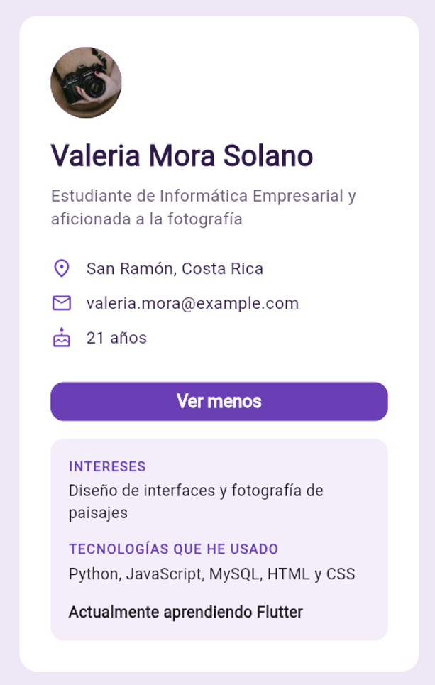

# Tarjeta de presentación en Flutter

Proyecto del **Grupo 3 (Flutter)** del curso **IF0009 Desarrollo de Software IV**, Universidad de Costa Rica, Sede de Occidente, Recinto de Tacares (II semestre 2026).

## ¿Qué es esta app?

Una app de una sola pantalla con una **tarjeta de presentación personal**: avatar con iniciales, nombre, una frase, tres datos con íconos (lugar, correo y edad) y un botón **Ver más** que muestra u oculta información adicional (intereses y tecnologías).

<!-- Agregar captura: guardar la imagen en docs/captura.png y descomentar la línea de abajo -->
<!--  -->

**Conceptos de Flutter que se practican:** widgets, `Column`, `Row`, `Text`, `CircleAvatar`, `Icon`, `Container`, `SizedBox`, `Expanded`, `StatelessWidget`, `StatefulWidget`, `setState` y eventos de botón (`onPressed`).

## Cómo ejecutar este proyecto

Requisito: tener Flutter instalado (ver [Preparar el ambiente](#preparar-el-ambiente)).

```bash
git clone https://github.com/Gerd-U/proyecto2_desarrollo.git
cd proyecto2_desarrollo
flutter pub get
flutter run -d chrome
```

1. `git clone` descarga una copia del proyecto.
2. `cd proyecto2_desarrollo` entra a la carpeta descargada.
3. `flutter pub get` descarga las dependencias.
4. `flutter run -d chrome` ejecuta la app en Google Chrome.

Con la app corriendo, en la terminal: `r` recarga los cambios, `R` reinicia la app y `q` la detiene.

Para correr la prueba automática (comprueba que "Ver más" muestra y oculta la información): `flutter test`.

## Requisitos y dependencias

| Requisito | Detalle |
|---|---|
| Flutter | Versión estable más reciente, que incluya Dart 3.13.7 o superior. Si es menor, ejecutar `flutter upgrade` |
| Dart | 3.13.7 o superior (viene incluido con Flutter) |
| Sistema operativo | Windows 10 u 11 (64 bits) |
| Navegador | Google Chrome |
| Editor recomendado | Visual Studio Code con las extensiones Flutter y Dart |
| Paquetes extra | Ninguno. Solo `cupertino_icons` y `flutter_lints` (desarrollo), que ya vienen en `pubspec.yaml` |
| Cuentas externas | No se necesita ninguna |

Para comprobar la versión: `flutter --version`.

En el resultado, la línea `Tools • Dart` debe decir 3.13.7 o más. Si dice un número menor, ejecutar `flutter upgrade` antes de la práctica; si no, `flutter pub get` va a fallar.

## Estructura del proyecto

```
lib/
  main.dart                     <- punto de entrada: arranca la app (MiApp)
  screens/
    perfil_screen.dart          <- arma la pantalla y la tarjeta
  widgets/
    encabezado_perfil.dart      <- avatar (foto) + nombre + frase (sin estado)
    fila_dato.dart              <- fila reutilizable de ícono + texto
    seccion_mas_info.dart       <- botón "Ver más" y la información extra (con estado)
test/
  widget_test.dart              <- prueba automática del botón "Ver más"
pubspec.yaml                    <- nombre, dependencias y versión mínima de Dart
```

## Preparar el ambiente

Todo esto se hace **antes** de la práctica.

1. **Visual Studio Code**: https://code.visualstudio.com/download
2. **Git**: https://git-scm.com/downloads/win (dejar las opciones por defecto).
3. **Google Chrome**: https://www.google.com/chrome/
4. **Extensiones**: en VS Code presionar `Ctrl + Shift + X`, buscar **Flutter** (publicada por Dart Code) e instalar. La extensión de Dart se instala sola.
5. **Flutter SDK y PATH**:
   1. En VS Code presionar `Ctrl + Shift + P` y escribir **Flutter: New Project**.
   2. Elegir **Download SDK**, escoger una carpeta sin espacios ni tildes (por ejemplo `C:\dev`) y presionar **Clone Flutter**.
   3. Cuando aparezca, elegir **Add SDK to PATH**.
   4. Cerrar VS Code por completo y volver a abrirlo.
6. **Verificar** en la terminal de VS Code:

   ```bash
   flutter --version
   flutter doctor
   flutter devices
   ```

   `flutter devices` debe listar **Chrome (web)**.

> **Android Studio es opcional.** Solo hace falta para usar un emulador de Android. Es normal que `flutter doctor` marque en rojo "Android toolchain" o "Visual Studio": no afecta esta práctica, que corre en Chrome.

Guía oficial: https://docs.flutter.dev/install/with-vs-code

## Errores comunes

| Mensaje o síntoma | Solución |
|---|---|
| `flutter` no se reconoce como comando | Agregar la carpeta `bin` de Flutter al PATH: Inicio > "Editar las variables de entorno de esta cuenta" > Path > Editar > Nuevo > `C:\dev\flutter\bin`. Aceptar, cerrar VS Code por completo y reabrirlo. |
| `No supported devices found` o no aparece Chrome | Instalar Chrome y comprobar con `flutter devices`. |
| `No pubspec.yaml file found` | La terminal está fuera del proyecto: ejecutar `cd proyecto2_desarrollo`. |
| Error de versión al ejecutar `flutter pub get` | La versión de Flutter es antigua. Actualizar con `flutter upgrade`. |
| Gradle o licencias de Android | Solo aplica si se usa Android Studio: `flutter doctor --android-licenses`. |
| La primera ejecución tarda mucho | Es normal: Flutter descarga archivos la primera vez. |
